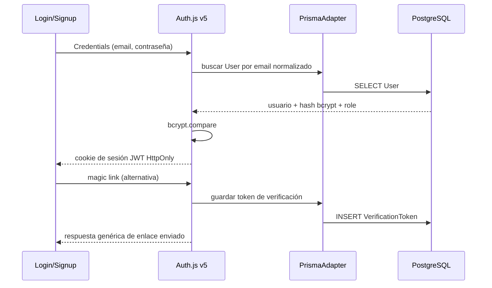
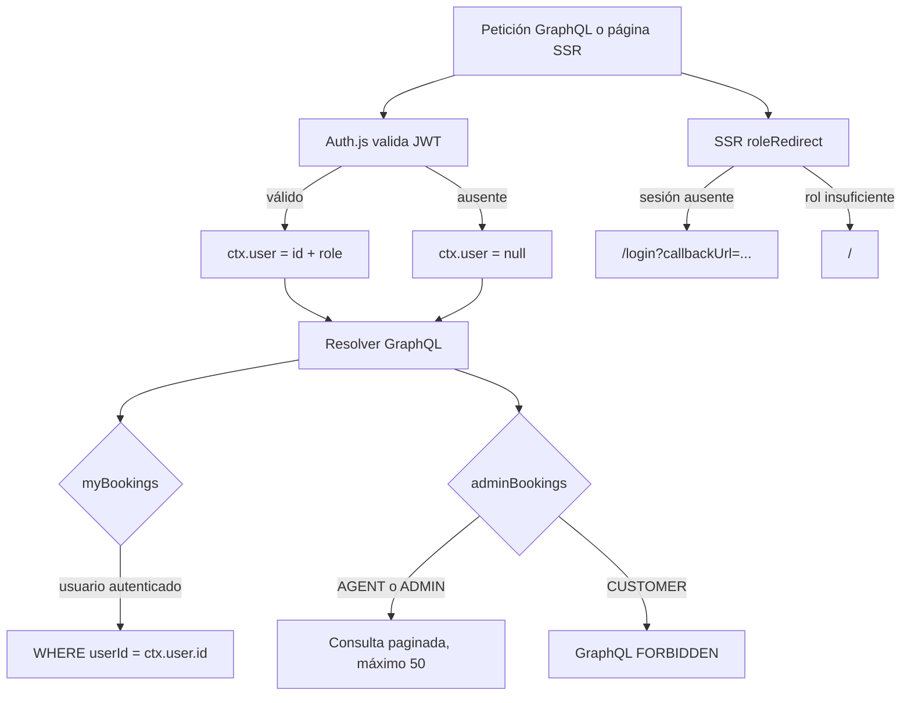

# Fase 2 — Autenticación y roles

## Estado

| Actividad | Estado | Implementación |
|---|---|---|
| 2A — Auth.js v5, Prisma Adapter, Credentials y magic link | ✅ | `server/auth.ts` y `pages/api/auth/[...nextauth].ts` |
| 2B — JWT con `id`/`role` y `ctx.user` | ✅ | Callbacks de Auth.js y `server/context.ts` |
| 2C — Query `me` y sesión en frontend | ✅ | `server/modules/auth.ts`, `features/auth/useMe.ts`, `SessionProvider` |
| 2D — Guards de rol backend/frontend | ✅ | `server/auth-guards.ts`, `features/auth/RequireRole.tsx`, SSR redirects |
| 2E — Página “Mis reservas” | ✅ | `pages/mis-reservas.tsx`, filtrado por `ctx.user.id` |

Se añadió también una vista de operaciones en `/admin`. En el Pages Router no hay un convenio de layouts por archivo como `pages/admin/_layout.tsx`; el layout protegido vive en `features/auth/AdminLayout.tsx` y se consume desde `pages/admin/index.tsx`.

## Flujo de inicio de sesión



En desarrollo, Nodemailer usa `jsonTransport` y el enlace de acceso se imprime en la terminal de Next con el formato `🔗 Magic link para <email>: <url>`. Ese enlace es un secreto de un solo uso: no lo compartas ni lo guardes en logs persistentes. En producción es obligatorio definir un transporte real.

## Flujo de autorización y reservas



La UI añade un guard cliente para evitar mostrar contenido durante la navegación, pero la decisión de seguridad se vuelve a tomar en el servidor. `createManualHotel` exige `ADMIN`; `adminBookings` permite `AGENT` y `ADMIN`, y ofrece filtros con paginación cursorada; `myBookings` requiere sesión y siempre filtra por la identidad confiable del contexto. La reserva de invitado (`createBooking`) sigue disponible.

## Credenciales de datos semilla

`prisma/seed.ts` asigna el mismo hash bcrypt de costo 10 a las cuentas de demostración:

| Rol | Email | Contraseña local |
|---|---|---|
| ADMIN | `admin@agencia.test` | `password123` |
| AGENT | `agente@agencia.test` | `password123` |
| CUSTOMER | clientes `@example.com` creados por el seed | `password123` |

Estos datos son solo para desarrollo y pruebas. No reutilices esas credenciales en producción. El seed actual vacía y vuelve a poblar las tablas de la aplicación; **no ejecutes `npm run seed` en una base de datos con datos que quieras conservar**.

## Configuración de entorno

Auth.js v5 utiliza `AUTH_SECRET` para firmar y cifrar cookies. Genera un secreto nuevo por entorno; no lo incluyas en documentación, commits ni logs. Para desplegar detrás de un proxy, configura `AUTH_TRUST_HOST=true` solo si el proxy/hosting valida el host entrante.

En producción configura además:

```dotenv
AUTH_SECRET=<secreto-aleatorio-del-entorno>
AUTH_TRUST_HOST=true
EMAIL_SERVER=smtp://<usuario>:<contraseña>@<servidor>:587
EMAIL_FROM=Aleca Travel <no-reply@tu-dominio.example>
```

`EMAIL_SERVER` no se exige para el transporte local de desarrollo; si se solicita un magic link en producción sin transporte configurado, la petición falla explícitamente. Mantén los valores reales únicamente en el gestor de secretos del despliegue. El proveedor local no envía emails.

## Validación

```bash
npx tsc --noEmit
npm run graphql:sync
npm test -- tests/auth.test.ts tests/booking-auth.test.ts
npm test
```

Las pruebas de integración usan Yoga local y una sesión inyectada en el contexto; no llaman al endpoint HTTP de Auth.js. Crean usuarios/reservas efímeros en la base `DATABASE_URL` del entorno de tests y limpian en `finally`. No truncan ni repueblan datos. Revisa que `DATABASE_URL` apunte a una base de pruebas/desarrollo antes de ejecutarlas.

Cobertura añadida:

- costo/hash bcrypt, verificación de password válido/incorrecto y límites UTF-8;
- registro con email normalizado, rol por defecto, hash persistido y conflicto por duplicado;
- autorización de Credentials con email normalizado y rechazo de credenciales incorrectas;
- `me` anónimo y con los tres roles;
- mapeo de la sesión y guardas `UNAUTHENTICATED`/`FORBIDDEN`;
- aislamiento de `myBookings`, autorización de `adminBookings` y vínculo de reserva a `ctx.user.id`.

## Decisiones y límites

- Se mantiene JWT, como requiere Credentials. El adaptador se usa para usuarios, cuentas y tokens de magic link; no para persistir sesiones activas en la tabla `Session`.
- El esquema ya incluía los modelos del adaptador y el campo nullable `User.password`, por eso no se necesitó una migración en esta tarea.
- El proveedor Nodemailer local imprime enlaces de autenticación según el requisito del proyecto. Los logs deben ser efímeros y de acceso restringido.
- Antes de producción, añade limitación de intentos para login/registro y protección antiabuso con un servicio compartido (no un contador en memoria que se reinicia por instancia).
- No se añadió recuperación de contraseña, revocación inmediata de JWT, MFA ni confirmación adicional al registro; son trabajos posteriores.
