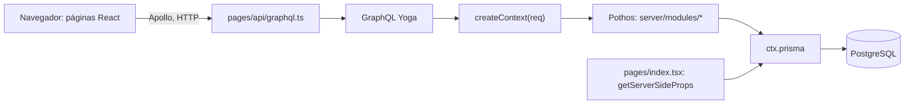
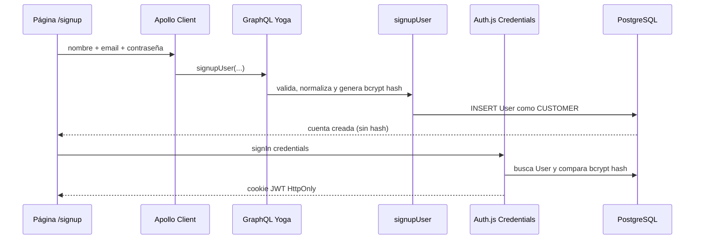
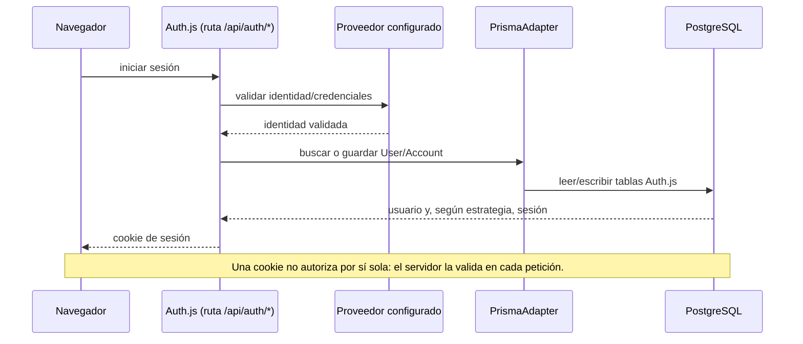
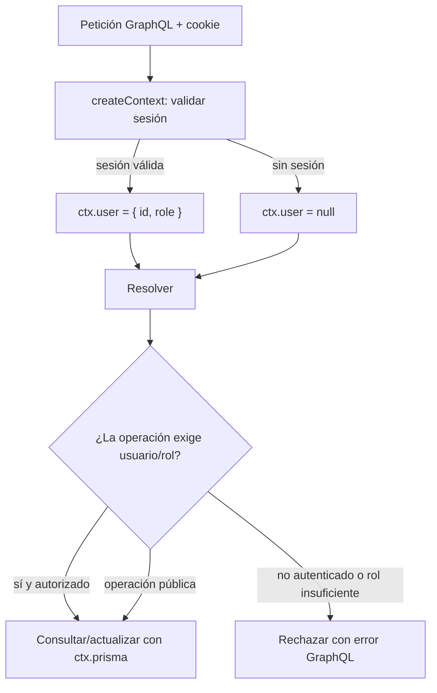

# Guía de arquitectura y Auth.js

Esta guía describe el código y los flujos ya implementados, además de sus puntos de extensión. El proyecto usa **Next.js Pages Router** (`pages/`), no App Router; tenlo en cuenta al copiar ejemplos de documentación que usan `app/api/...`.

## Resumen de la arquitectura actual

- **UI:** páginas React en `pages/`; Apollo Client ejecuta operaciones GraphQL desde el navegador.
- **API:** `pages/api/graphql.ts` crea un servidor GraphQL Yoga. `server/schema.ts` importa módulos que registran queries/mutations en el `builder` compartido.
- **Tipos/API GraphQL:** Pothos define los tipos y resolvers en `server/modules/`. `lib/pothos-prisma-types.ts` es generado para que el plugin Prisma conozca el modelo.
- **Datos:** los resolvers reciben `ctx.prisma` y usan el Prisma Client generado, conectado a PostgreSQL.
- **Excepción importante:** la portada (`pages/index.tsx`) consulta Prisma directamente en `getServerSideProps`; esa lectura no pasa por GraphQL.

## Cómo se construye una operación GraphQL

1. `server/builder.ts` crea la única instancia de Pothos y le configura el tipo `Context`, el cliente Prisma y escalares como `Date`/`DateTime`.
2. `server/schema.ts` importa `catalog`, `booking`, `user` y `auth`. Esos imports ejecutan el código de cada módulo y registran sus tipos y campos en el builder.
3. `builder.toSchema()` convierte esos registros en el esquema que Yoga ejecuta. El mismo esquema se usa para la API, exportar `schema.graphql` y las pruebas.
4. Para cada petición, `pages/api/graphql.ts` llama a `createContext(req, res)`. Auth.js valida la sesión y Yoga pasa el contexto resultante como `ctx` a los resolvers.
5. Un resolver valida argumentos, consulta o modifica datos a través de `ctx.prisma`, y Pothos forma la respuesta GraphQL solicitada.

El cliente debería pedir solo los campos que necesita. En el camino GraphQL, Apollo envía esa selección al servidor y el plugin Prisma puede aprovecharla para optimizar relaciones. La página principal hoy no usa ese camino: hace una consulta Prisma del lado servidor y serializa el resultado para React.

## Integración Auth.js implementada

- `server/auth.ts` configura Auth.js v5, Prisma Adapter, estrategia JWT y los providers Credentials/Nodemailer.
- `pages/api/auth/[...nextauth].ts` adapta los handlers web de Auth.js v5 a la API tradicional del Pages Router.
- `server/context.ts` valida la cookie mediante `auth(req, res)` una vez por petición GraphQL y proyecta una identidad mínima en `ctx.user`.
- `server/modules/auth.ts` proporciona `signupUser` (email normalizado y contraseña bcrypt) y `me`.
- `server/auth-guards.ts` concentra la autorización de resolvers; `features/auth/RequireRole.tsx` y `roleRedirect.ts` protegen también la UI.
- `pages/login.tsx` ofrece contraseña y magic link; `pages/signup.tsx` crea la cuenta y luego inicia sesión con Credentials.
- `pages/mis-reservas.tsx` consulta reservas acotadas y `pages/admin/index.tsx` presenta el panel de operaciones.

El `SessionProvider` comparte la sesión en el cliente. El callback JWT agrega `id` y `role`; el callback de sesión los expone, y la augmentación de tipos refleja ese contrato en compilación. Las tablas del adapter ya estaban presentes en Prisma, por lo que esta integración no exige una migración nueva.

## Modelo mental de Auth.js en esta aplicación

Auth.js autentica al usuario y administra su sesión; no sustituye a toda la autorización de la API.

- **Usuario (`User`):** identidad local de la aplicación.
- **Cuenta (`Account`):** vínculo con una identidad externa (por ejemplo, GitHub o Google). La contraseña de una cuenta externa no se guarda aquí.
- **Sesión:** en esta integración la estrategia es JWT, no sesiones de base de datos. `Session` permanece en el esquema porque el adaptador Prisma implementa su contrato; el flujo de sesión activa vive en una cookie firmada/HttpOnly.
- **Adaptador (`PrismaAdapter`):** traduce las operaciones internas de Auth.js a las tablas de Prisma. Las tablas deben coincidir con el contrato del adaptador.
- **Proveedor:** Credentials busca el email normalizado y compara bcrypt; Nodemailer emite enlaces de un solo uso, guardando el token de verificación mediante el adaptador.
- **Rol (`User.role`):** autorización de la aplicación. Se debe leer del usuario validado en el servidor y transportar a la sesión mediante los callbacks adecuados. No se acepta un rol proveniente del navegador.

## Punto de unión: contexto de GraphQL

El contexto es el puente entre Auth.js y todos los resolvers. El flujo recomendado es:

1. Yoga obtiene la petición HTTP y la entrega al constructor de contexto.
2. El código del servidor valida la sesión de Auth.js para esa petición.
3. Si existe, mapea únicamente los datos necesarios a `SessionUser` (`id` y `role`); si no, deja `user` como `null`.
4. Los resolvers usan `ctx.user` para asociar o autorizar operaciones. El usuario nunca debe venir de un argumento GraphQL modificable por el cliente.

`createContext(req, res)` espera la respuesta de Next porque la API Pages Router de Auth.js necesita ambos objetos para verificar sesiones. Yoga recibe ambos y construye `ctx` una vez por petición.

**Autenticar no equivale a autorizar.** Auth.js completa `ctx.user`, pero cada operación privada debe comprobar la identidad y, cuando aplique, el rol en el servidor. `createManualHotel` exige ADMIN, las consultas administrativas exigen AGENT/ADMIN y “mis reservas” limita la consulta por `ctx.user.id`; nunca acepta un `userId` arbitrario del cliente.

## Próximas mejoras antes de producción

La integración actualmente incluye Credentials y magic links, no OAuth. Antes de exponerla públicamente, configura los secretos y el SMTP descritos en [AUTH.md](./AUTH.md), añade rate limiting externo para registro/login y un mecanismo de recuperación de contraseña. El registro asigna siempre CUSTOMER; los roles de staff deben provisionarse por un proceso confiable, nunca por una mutation pública.

Las páginas que llaman GraphQL desde el navegador son mismo-origen y envían la cookie de sesión junto con la petición. Si se ejecuta Apollo en el servidor, no asumas que el `HttpLink` reenvía las cookies entrantes: propágalas explícitamente solo cuando ese flujo SSR necesite autenticación.
